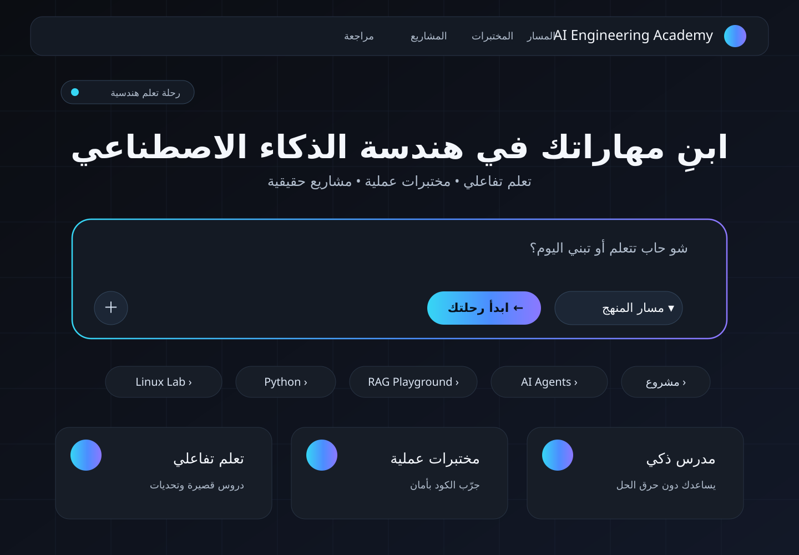
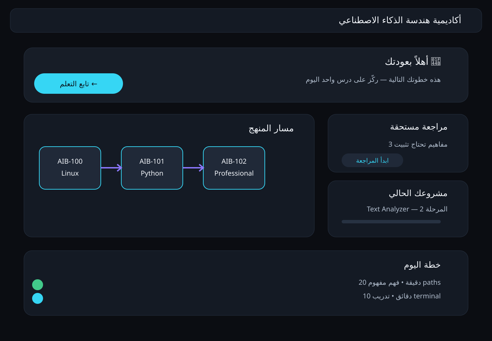
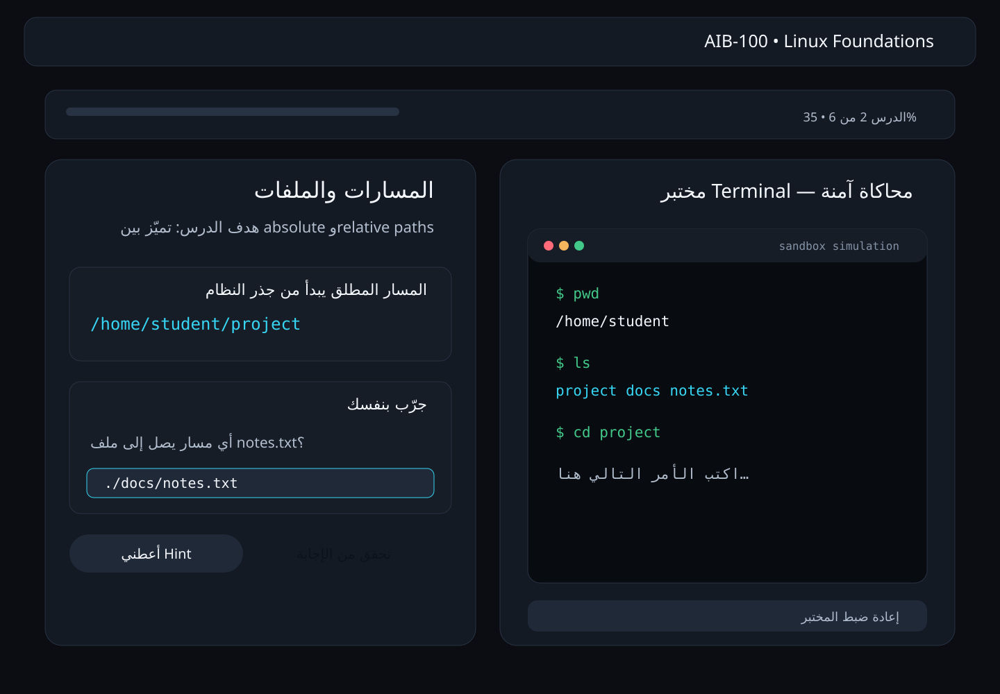

# AI Backend Engineering — Interactive Learning Platform

منصة تعليمية عربية/إنجليزية تحول منهج AI Backend Engineering — Python on Linux إلى رحلة تفاعلية ومبنية على المشاريع، بدل تجربة PDF وفيديوهات فقط.

**الحالة:** Stage 0 — Product/design groundwork. No app implementation yet.

## Vision
افهم → جرّب → اكتب كودًا → اختبر → اشرح → ابنِ مشروعًا → احصل على feedback.

## UI direction
Prompt-first experience inspired by the uploaded screenshot (layout inspiration only; no Gemini branding/assets copied). Dark-first premium engineering academy with restrained cyan/blue/violet, semantic tokens, whitespace, Arabic RTL, complete light theme and accessibility.

### Screen concept mockups

### Concept diagrams

## Docs
- [Product Vision](docs/01-product-vision.md)
- [Learning Experience](docs/02-learning-experience.md)
- [Curriculum Map](docs/03-curriculum-map.md)
- [Architecture](docs/04-architecture.md)
- [Roadmap](docs/05-roadmap.md)
- [Original stage prompts](docs/06-stage-prompts.md)
- [Visual direction](docs/07-visual-direction.md)
- [MVP backlog](docs/08-mvp-backlog.md)
- [Reference screenshot analysis](docs/09-reference-analysis.md)
- [Design system research & palette](docs/10-design-system-research.md)
- [Screen-by-screen specification](docs/11-visual-screen-spec.md)
- [Gemini Build Mode master prompt](docs/12-gemini-build-master-prompt.md)
- [Expanded stage prompts](docs/13-stage-prompts-expanded.md)
- [UI prompt library](docs/14-ui-prompt-library.md)
- [Image asset briefs](docs/15-image-asset-briefs.md)
- [Implementation handoff](docs/16-implementation-brief.md)

## MVP
Course map, schema-based lesson blocks, checkpoints, hints, quizzes, local progress, spaced review, dashboard, responsive RTL/LTR, AIB-100 content and safe simulated terminal.

## Safety
Do not run student code in the main API/worker. Real code execution later requires isolated sandboxing, resource limits, blocked network/secrets, cleanup and security review.

## Stage gates
Each stage has defined output, validation and acceptance criteria. Don't advance until reviewed.
