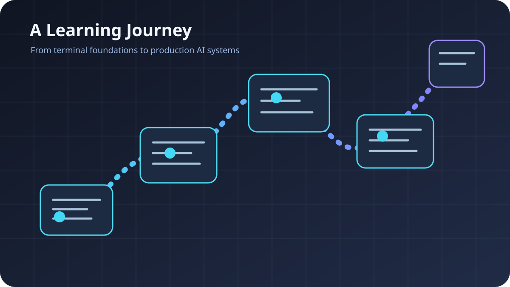
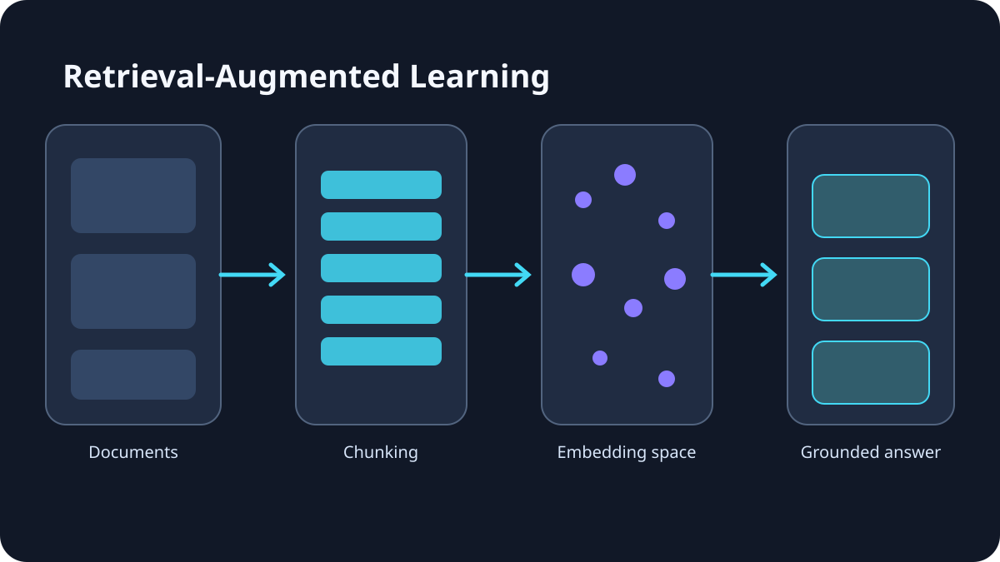
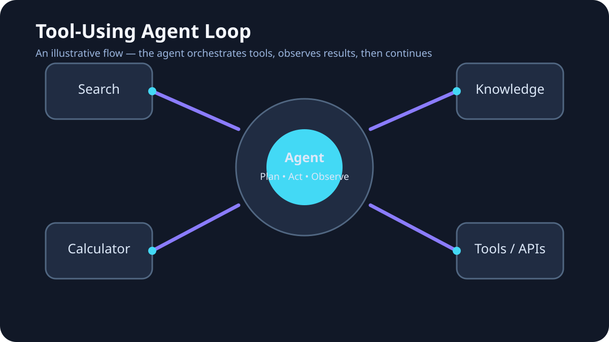

# AI Backend Engineering — Interactive Learning Platform

منصة تعليمية عربية/إنجليزية تحول منهج AI Backend Engineering — Python on Linux إلى رحلة تفاعلية وعملية ومبنية على المشاريع، بدل تجربة PDF وفيديوهات فقط.

**الحالة:** Stage 0 — تخطيط وتصميم، لم يبدأ التطوير البرمجي بعد.

## الرؤية
دورة تعلم متكررة: افهم → جرّب → اكتب كودًا → اختبر → اشرح → ابنِ مشروعًا → احصل على feedback.

## Concept art (illustrative)

## الوثائق
- [Product Vision](docs/01-product-vision.md)
- [Learning Experience](docs/02-learning-experience.md)
- [Curriculum Map](docs/03-curriculum-map.md)
- [Architecture](docs/04-architecture.md)
- [Roadmap](docs/05-roadmap.md)
- [Stage Prompts](docs/06-stage-prompts.md)
- [Visual Direction](docs/07-visual-direction.md)
- [MVP Backlog](docs/08-mvp-backlog.md)

## MVP
Course map، دروس بمحتوى blocks، checkpoints، hints، quizzes، progress، مراجعة متباعدة، dashboard، تجربة responsive وRTL/LTR، محتوى AIB-100.

## Safety
لا تنفذ كود الطلاب في API أو worker عادي. تشغيل الكود لاحقًا يتطلب sandbox معزول وحدود موارد وحجب network/secrets وcleanup.

## مراحل التنفيذ
كل مرحلة لها هدف ومخرجات واختبارات وAcceptance gate. لا نقفز للمرحلة التالية قبل المراجعة.
